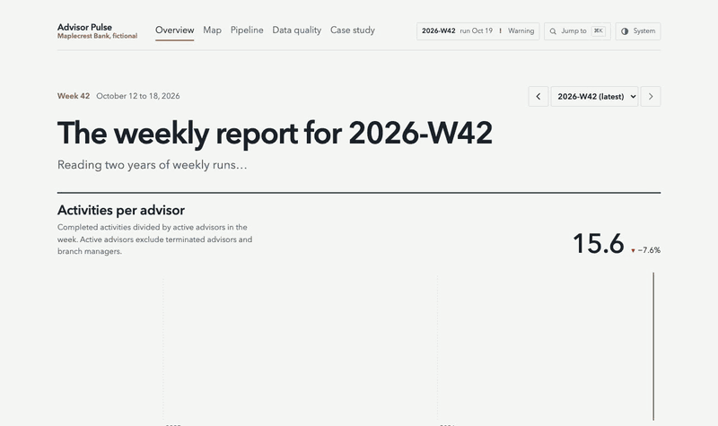
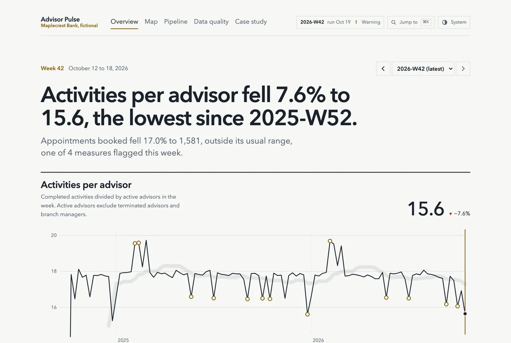
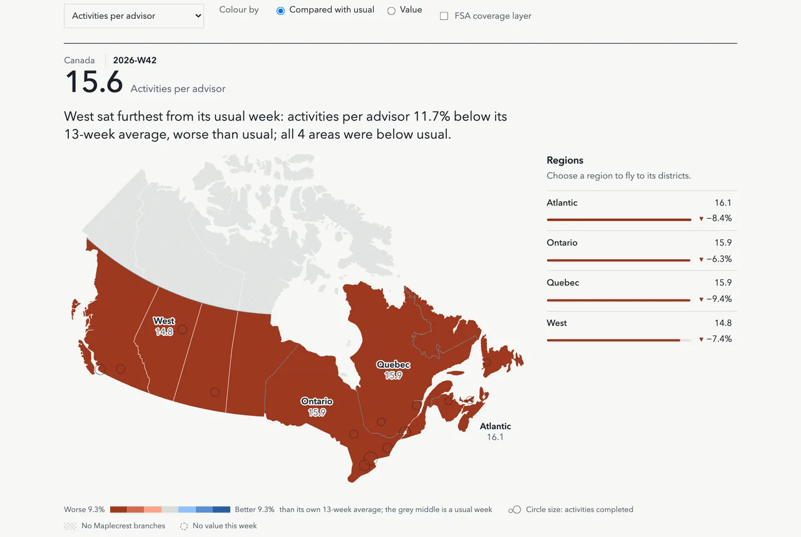
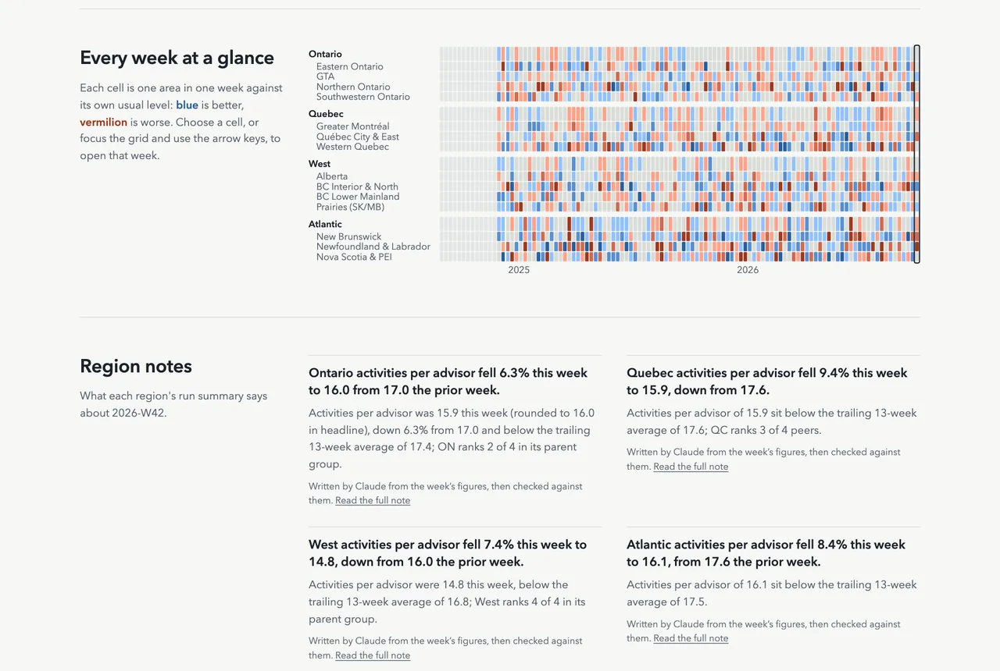
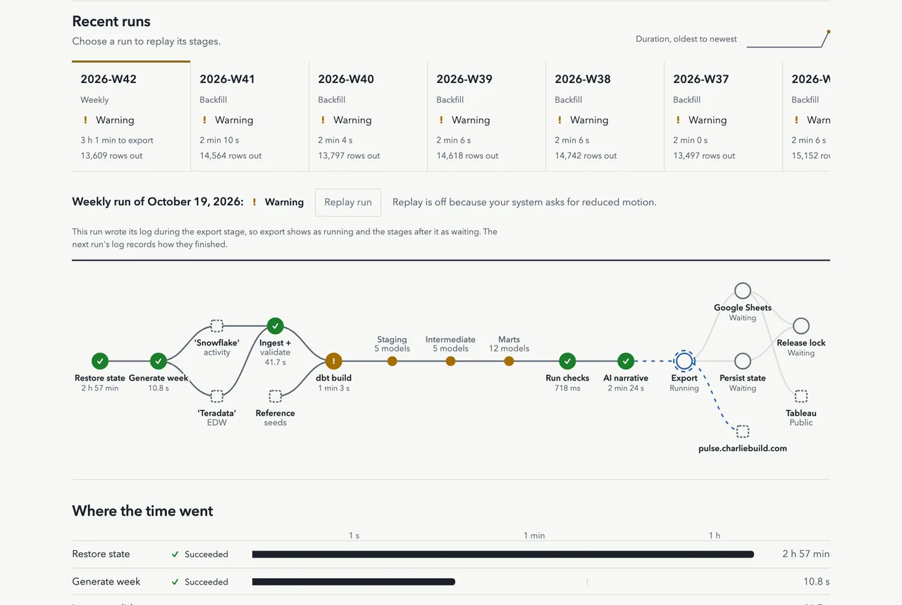
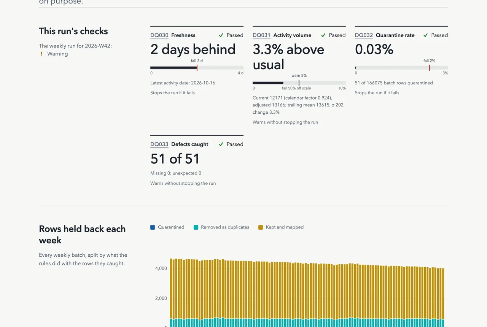
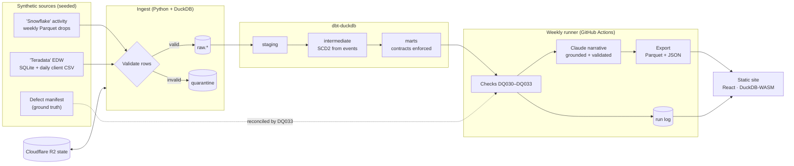

# Advisor Pulse

**Is every client in an advisor's portfolio hearing from the bank at least once a year?** Advisor Pulse answers that every Monday for Maplecrest Bank, a fictional Canadian bank, and backs every number with tests you can read.

## For reviewers: three minutes

1. **0:00–0:45** — Read the business question, weekly measure and drill-down in the [weekly report](https://pulse.charliebuild.com/).
2. **0:45–1:30** — Inspect how assignment events rebuild point-in-time ownership in the [SCD2 model](dbt/models/intermediate/int_advisor_history.sql#L1).
3. **1:30–2:15** — Read the repeat-run and crash-recovery evidence in the [idempotency tests](tests/integration/test_idempotency.py#L84).
4. **2:15–3:00** — Compare the demonstrated capabilities, limits and tracked gaps with the [job-sample evidence map](docs/reviewer-map.md).

The lead measure is **portfolio contacted (12 months)**: of the active clients in a portfolio at week end, the share who had at least one completed contact, by any advisor, in the last 12 months. It rolls up from portfolio to advisor, branch, district, region and the nation, from counts rather than averaged rates, and it stays blank until a full year of history exists ([ADR 0005](docs/adr/0005-twelve-month-contact-window.md)).

Behind it is a weekly batch pipeline: two messy synthetic source systems, an incremental load with quarantine, a dbt star schema on DuckDB, data-quality checks reconciled against an answer key, and short weekly notes written by Claude and checked against the figures. The result is a static report at [pulse.charliebuild.com](https://pulse.charliebuild.com) that the browser queries with DuckDB-WASM, with the [dbt lineage graph](https://pulse.charliebuild.com/lineage/) beside it.

| 107 weeks | 2.2M activity rows | 107 of 107 weeks | 10 min | 1 h 18 min |
|---|---|---|---|---|
| of history, rebuilt from events | loaded incrementally, 5,967 quarantined | reconciled every injected defect, nothing missing | per weekly run, plus about 9 min of model narratives | for a rebuild of all history on GitHub Actions |

Stack: Python, SQL, dbt, DuckDB, GitHub Actions, Cloudflare R2 and Pages, TypeScript, React, DuckDB-WASM, Claude.

> **All data is synthetic.** The bank, its people, clients, schemas and business rules are invented. Only public geography (Statistics Canada FSA boundaries, province names) is real. This is a **weekly batch report**: it updates once a week, after the weekly run.

## My role

I set the goals, made the design calls and own the result, working with AI coding agents as my team. Each call below has a test or an ADR behind it, and I can walk through any of them:

- **Contracts first.** One set of Python contracts generates the JSON schemas, the dbt sources and the TypeScript types, so a renamed column fails CI instead of a Monday report.
- **History from events.** Advisor and portfolio ownership are SCD Type 2 ranges rebuilt from assignment events, so a backfill of any week reproduces it exactly ([ADR 0001](docs/adr/0001-scd2-from-events.md)).
- **The portfolio model and its migration.** I added portfolios as their own entity and moved the lead KPI to them with an expand/contract migration across ten small pull requests, keeping the old path running until a full rebuild proves the new one ([ADR 0003](docs/adr/0003-portfolio-entity.md), [ADR 0004](docs/adr/0004-expand-contract-migration.md)).
- **Data quality you can prove.** The generator writes an answer key of every defect it injects, and a check compares it with what the pipeline caught, every week.
- **A narrow, grounded LLM.** Claude writes the weekly notes from a list of cited facts; a validator rejects any number that isn't in them and falls back to a template.

I ran the build like a small team lead. The plan, the contracts and a backlog of small issues came first; coding agents (Claude Code, Codex, Cursor) implemented the issues one pull request each. Every pull request got an automated review against the checklist in [AGENTS.md](AGENTS.md), and I approved every contract and design change.



## What the site shows

| | |
|---|---|
|  |  |
| **Overview.** The headline is written from the numbers. The chart plots any of twelve measures across every weekly run, with the trailing 13-week average as a "usual" ribbon. | **Map.** Provinces take their serving region's colour, compared with that region's own usual week; choose a region to fly to its districts, or play the weeks. |
|  |  |
| **Every week at a glance.** Each cell is one area in one week against its own usual level; holidays and seasons show as vertical bands. | **Pipeline.** The weekly DAG on one screen, a replay of the last run, and a log-scale timeline so a 3-hour rebuild and a 1-second step fit together. |



There is no chart engine: lines, the heatmap and the map are hand-written SVG, and bars (funnel, bullets, the pipeline timeline) are plain HTML and CSS. Every chart reads its colours from design tokens, has a table of the same numbers, works by keyboard, and turns its motion off under reduced motion. CI holds each route to a 350 KiB JavaScript budget (`web/tests/bundle-budget.mjs`).

## What it demonstrates

Each skill an analytics or data engineer is asked about, and where it lives in the code.

| Skill | Where |
|---|---|
| Incremental, idempotent loads: watermarks, file hashes, one transaction per batch | [`src/pulse/ingest/`](src/pulse/ingest/), [`meta.py`](src/pulse/ingest/meta.py) |
| Data contracts as the single source of truth: schemas, dbt sources and TypeScript types generated from them | [`src/pulse/contracts/`](src/pulse/contracts/), [`codegen.py`](src/pulse/contracts/codegen.py) |
| Dimensional modelling: staging → intermediate → marts, a star schema with enforced contracts | [`dbt/models/`](dbt/models/) |
| SCD Type 2 from events, and point-in-time attribution | [`int_advisor_history.sql`](dbt/models/intermediate/int_advisor_history.sql), [`int_client_book_weekly.sql`](dbt/models/intermediate/int_client_book_weekly.sql) |
| Ratios rolled up from numerators and denominators, reconciled at every level | [`reconcile_org_weekly.sql`](dbt/tests/reconcile_org_weekly.sql), [`mart_org_quarterly.sql`](dbt/models/marts/mart_org_quarterly.sql) |
| Data quality proven against ground truth: injected defects vs quarantined rows | [`dirt.py`](src/pulse/generate/dirt.py), [`checks.py`](src/pulse/quality/checks.py) |
| Orchestration and failure handling: a DAG with retries, run log, alerts, state and a lock in object storage | [`src/pulse/runner/`](src/pulse/runner/), [`src/pulse/state/`](src/pulse/state/) |
| Grounded LLM output: facts in, every number validated, template fallback | [`src/pulse/narrative/`](src/pulse/narrative/), [`validate.py`](src/pulse/narrative/validate.py) |
| CI/CD: `dbt build` on fixtures, bundle budgets, a self-continuing backfill | [`.github/workflows/`](.github/workflows/) |

## Read more

- [Code tour](docs/code-tour.md): eight stops through the code in data-flow order, each with the lines worth reading and the test that proves them. Start here if you have 20 minutes.
- [dbt lineage](https://pulse.charliebuild.com/lineage/): every model, column and test, from sources to the pages that read them.
- [Decision records](docs/adr/): SCD2 from events, the geo size budget, the portfolio entity, the expand/contract migration and the 12-month window.
- [Case study](docs/case-study.md): the problem, key decisions and tradeoffs, data quality, and what would change at real scale. It is also on the site at [/case-study](https://pulse.charliebuild.com/case-study).
- [Baseline](docs/baseline.md): row counts, durations, export sizes and defect catch rate for the latest 107-week rebuild.
- [PLAN.md](docs/PLAN.md): architecture, data dictionary, KPIs, data-quality rules and failure handling.
- [AGENTS.md](AGENTS.md): how humans and coding agents (Claude Code, Codex, Cursor) work in this repo.

## Architecture



## Quickstart

You need Python 3.12, [uv](https://docs.astral.sh/uv/), Node 22 and pnpm. From a clean clone, the steps below take about four minutes on a laptop. The two-week backfill accounts for three of them.

```bash
make setup                               # Python, web and dbt dependencies
make web-dev                             # the site on bundled fixture data: http://localhost:5173
make web-dev-latest                      # the site on the latest published weekly export, every region (needs gh)
```

The fixtures are a small Ontario and Quebec slice, so the other provinces show "No data" under `make web-dev`.

To run the real pipeline (generate, ingest, dbt build, checks, template narratives, export) for two weeks at full scale:

```bash
make backfill FROM=2026-W39 TO=2026-W40  # writes data/ and web/public/data/
(cd web && pnpm build && pnpm preview)  # the site on your own run
```

- **Narrative backend:** no API key is needed. Without a model backend the narrative stage writes template notes and warns. See `.env.example` for the backend options.
- **Other targets:** `make help` lists them all.
- **Before a PR:** run `make check` (lint, types, tests, contracts) and `make web-check` (lint, types, Vitest, build, Playwright).

## Where things live

| Concept | Code |
|---|---|
| Contracts (one source of truth for every schema) | [`src/pulse/contracts/`](src/pulse/contracts/) |
| Seeded generator and defect injection | [`src/pulse/generate/`](src/pulse/generate/) |
| Watermarks, file manifest, quarantine, idempotent batches | [`src/pulse/ingest/`](src/pulse/ingest/) |
| Staging, SCD2 advisor history, client books, marts | [`dbt/models/`](dbt/models/) ([ADR: SCD2 from events](docs/adr/0001-scd2-from-events.md)) |
| Data-quality checks and reconciliation (DQ030–DQ033) | [`src/pulse/quality/`](src/pulse/quality/) |
| Weekly runner, DAG, retries, backfill, alerting | [`src/pulse/runner/`](src/pulse/runner/) |
| State persistence to R2 and run lock | [`src/pulse/state/`](src/pulse/state/) |
| Grounded narratives, validator, cache, eval | [`src/pulse/narrative/`](src/pulse/narrative/) |
| Export to Parquet and JSON with a size budget | [`src/pulse/export/`](src/pulse/export/) |
| Site: data layer (DuckDB-WASM) and theme | [`web/src/data/`](web/src/data/), [`web/src/theme/`](web/src/theme/) |
| Site: hand-written SVG charts (trend, stacked weeks, bullet) | [`web/src/components/charts/`](web/src/components/charts/) |
| Site: overview, drill, map, pipeline replay, data quality, case study, app shell | [`web/src/features/`](web/src/features/), [`web/src/app/`](web/src/app/) |
| Weekly, backfill and CI workflows; Pages deploy | [`.github/workflows/`](.github/workflows/), [`.github/actions/`](.github/actions/) |
| End-to-end test (8-week backfill plus a weekly run) | [`tests/integration/test_e2e.py`](tests/integration/test_e2e.py) |

## License

MIT
