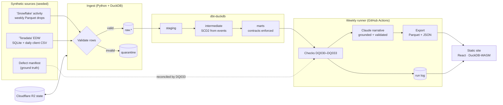

# Advisor Pulse

Advisor Pulse is a weekly batch BI pipeline for **Maplecrest Bank**, a fictional Canadian bank. It tracks how much client activity each advisor has. It takes two messy synthetic source systems through an incremental load with quarantine, a dbt star schema on DuckDB, data-quality checks reconciled against known ground truth, and short weekly notes written by Claude and checked against the figures. The result is a static report, published at [pulse.charliebuild.com](https://pulse.charliebuild.com), that the browser queries with DuckDB-WASM.

> **All data is synthetic.** The bank, its people, clients, schemas and business rules are invented. Only public geography (Statistics Canada FSA boundaries, province names) is real. This is a **weekly batch report**: it updates once a week, after the weekly run.


## What the site shows

| | |
|---|---|
|  |  |
| **Overview.** The headline is written from the numbers. The chart plots any of twelve measures across every weekly run, with the trailing 13-week average as a "usual" ribbon. | **Map.** Provinces take their serving region's colour, compared with that region's own usual week; choose a region to fly to its districts, or play the weeks. |
|  |  |
| **Every week at a glance.** Each cell is one area in one week against its own usual level; holidays and seasons show as vertical bands. | **Pipeline.** The weekly DAG on one screen, a replay of the last run, and a log-scale timeline so a 3-hour rebuild and a 1-second step fit together. |


Every chart is hand-written SVG (no chart engine), reads its colours from design tokens, has a table of the same numbers, works by keyboard, and turns its motion off under reduced motion. Each route loads 80 to 131 KB of JavaScript, gzip.

## Read more

- [Case study](docs/case-study.md): the problem, key decisions and tradeoffs, data quality, and what would change at real scale. It is also on the site at [/case-study](https://pulse.charliebuild.com/case-study).
- [Baseline](docs/baseline.md): row counts, durations, export sizes and defect catch rate for a 104-week run.
- [PLAN.md](docs/PLAN.md): architecture, data dictionary, KPIs, data-quality rules and failure handling.
- [AGENTS.md](AGENTS.md): how humans and coding agents (Claude Code, Codex, Cursor) work in this repo.

## Architecture



## Quickstart

You need Python 3.12, [uv](https://docs.astral.sh/uv/), Node 22 and pnpm. From a clean clone, the steps below take about four minutes on a laptop. The two-week backfill accounts for three of them.

```bash
make setup                               # Python, web and dbt dependencies
make web-dev                             # the site on bundled fixture data: http://localhost:5173
make web-dev-latest                      # the site on the latest published weekly export, every region (needs gh)
```

The fixtures are a small Ontario and Quebec slice, so West and Atlantic show "No data" under `make web-dev`.

To run the real pipeline (generate, ingest, dbt build, checks, template narratives, export) for two weeks at full scale:

```bash
make backfill FROM=2026-W39 TO=2026-W40  # writes data/ and web/public/data/
(cd web && pnpm build && pnpm preview)  # the site on your own run
```

- **Narrative backend:** no API key is needed. Without a model backend the narrative stage writes template notes and warns. See `.env.example` for the backend options.
- **Other targets:** `make help` lists them all.
- **Before a PR:** run `make check` (lint, types, tests, contracts) and `make web-check` (lint, types, Vitest, build, Playwright).

## Where things live

| Concept | Code |
|---|---|
| Contracts (one source of truth for every schema) | [`src/pulse/contracts/`](src/pulse/contracts/) |
| Seeded generator and defect injection | [`src/pulse/generate/`](src/pulse/generate/) |
| Watermarks, file manifest, quarantine, idempotent batches | [`src/pulse/ingest/`](src/pulse/ingest/) |
| Staging, SCD2 advisor history, client books, marts | [`dbt/models/`](dbt/models/) ([ADR: SCD2 from events](docs/adr/0001-scd2-from-events.md)) |
| Data-quality checks and reconciliation (DQ030–DQ033) | [`src/pulse/quality/`](src/pulse/quality/) |
| Weekly runner, DAG, retries, backfill, alerting | [`src/pulse/runner/`](src/pulse/runner/) |
| State persistence to R2 and run lock | [`src/pulse/state/`](src/pulse/state/) |
| Grounded narratives, validator, cache, eval | [`src/pulse/narrative/`](src/pulse/narrative/) |
| Export to Parquet and JSON with a size budget | [`src/pulse/export/`](src/pulse/export/) |
| Site: data layer (DuckDB-WASM) and theme | [`web/src/data/`](web/src/data/), [`web/src/theme/`](web/src/theme/) |
| Site: hand-written SVG charts (trend, stacked weeks, bullet) | [`web/src/components/charts/`](web/src/components/charts/) |
| Site: overview, drill, map, pipeline replay, data quality, case study, app shell | [`web/src/features/`](web/src/features/), [`web/src/app/`](web/src/app/) |
| Weekly, backfill and CI workflows; Pages deploy | [`.github/workflows/`](.github/workflows/), [`.github/actions/`](.github/actions/) |
| End-to-end test (8-week backfill plus a weekly run) | [`tests/integration/test_e2e.py`](tests/integration/test_e2e.py) |

## How it was built

The work ran as GitHub issues in waves.
- **Wave 0** set up contracts and deterministic fixtures. Every later lane could then build in parallel against fixtures.
- **The agents:** Claude Code, Codex and Cursor each took issues by label and opened one small pull request per issue.
- **Review:** Claude reviewed every PR against the checklist in [AGENTS.md](AGENTS.md). The human owner approved contract and plan changes.

## License

MIT
