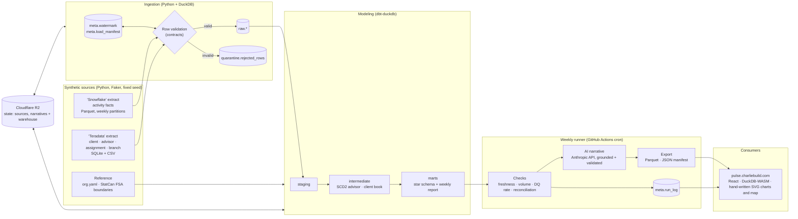

# Advisor Pulse — Project Plan

> An end-to-end, weekly-batch BI pipeline that tracks advisor activity at a **fictional** Canadian bank
> (Maplecrest Bank), from synthetic multi-source extracts to an editorial web dashboard at
> **pulse.charliebuild.com**. All data is synthetic: no real bank names, schemas, rules, or people.

Status: planning · Owner: Charlie G · Last updated: 2026-10-13

---

## 1. Goals

| # | Goal | How we know |
|---|------|-------------|
| G1 | Show production-grade data engineering, not a demo script | Incremental, idempotent loads; quarantine; contracts; tests; retries; alerting; backfill; run logs |
| G2 | Show BI depth from a reporting-manager background | Real hierarchy roll-ups, SCD2 attribution, KPI definitions a business would sign off on |
| G3 | Show AI engineering judgment | LLM weekly narratives that are grounded, validated, cached, and fail safe |
| G4 | Ship something people want to look at | An editorial, fast, accessible dashboard; no template look |
| G5 | Make the build process itself part of the story | Public repo, issue-driven multi-agent workflow, clean PR history |

**Non-goals:** real-time streaming, a production auth layer, multi-tenant hosting, any real bank's data or rules.

**Honesty rule:** the product is a **weekly batch report**. Every surface says "Week of …, last weekly run …", never "live".
The pipeline diagram *replays* the most recent weekly run from its run log.

---

## 2. Architecture



### Weekly run sequence

1. **Restore state** from R2 (sources, published narratives and their model cache, `warehouse.duckdb`, watermarks). Acquire run lock.
2. **Generate** the week that just closed, plus late-arriving records for up to 3 prior weeks (simulates upstream).
3. **Ingest** files newer than the watermark and not already in `load_manifest`; validate rows; quarantine rejects.
4. **dbt build**: staging → intermediate → marts, with tests and contracts enforced.
5. **Checks**: freshness, volume anomaly, quarantine rate, roll-up reconciliation. Policy decides warn vs fail.
6. **Narrative**: generate a grounded summary per region and district; validate; fall back to a template if needed.
7. **Export** marts to Parquet plus `manifest.json`, `run_log.json`, `pipeline_graph.json`, narratives.
8. **Deploy** to Cloudflare Pages; **persist state** to R2; release lock.

On failure, data is **not** redeployed: the site keeps the last good week, and only the run status is updated (see §10).

**Persist state depends on checks, not export (#167).** Once a week has loaded and passed its checks (SUCCESS or WARN), the warehouse goes to R2 even if the narrative or export later fails, so a failed export never throws away a 3-hour cold rebuild (#162). R2 can then hold week N while the site still shows N−1; the next good run exports every week and the two meet again. Failed checks skip persist, so R2 never holds a week that did not pass.

---

## 3. Tech choices and tradeoffs

| Area | Choice | Why | Tradeoff / alternative considered |
|------|--------|-----|------------------------------------|
| Language / env | Python 3.12, `uv`, `ruff`, `pytest` | Fast, reproducible, one lockfile | Poetry is more familiar, but slower |
| Synthetic data | Faker (`en_CA`) + NumPy, fixed seed per week | Deterministic: same seed and week give the same bytes, which makes rebuilds and tests possible | Mimesis is faster; Faker is more recognizable |
| "Snowflake" source | Local Parquet, Hive-style `extract_date=` partitions | Mirrors a real unload, so watermarks and late files become meaningful | Real Snowflake trial: costs money, expires |
| "Teradata" source | SQLite file + daily CSV extracts, Teradata-style `UPPER_SNAKE` abbreviated columns | Different formats and naming force a real staging layer | Postgres in Docker: heavier for agents and CI |
| Warehouse | DuckDB | Columnar, zero-ops; the same engine runs in the browser (WASM) | SQLite: row store, weaker analytics SQL |
| Transformation | dbt-core + dbt-duckdb | Industry standard: tests, contracts, docs, lineage | SQLMesh has better incrementals, but less hiring signal |
| SCD2 advisor | Built **deterministically** from assignment events in an intermediate model | Rebuildable on backfill; `dbt snapshot` depends on wall-clock run time and breaks idempotent backfills | Snapshots are documented as the "if the source had no history" path |
| Contracts | Pydantic models → JSON Schema; dbt model contracts on marts | One source of truth used by the generator, ingestion, export, and the frontend's types | Great Expectations: heavy for this scale |
| Orchestration | GitHub Actions cron + a thin Python runner (`pulse run`) | Free; runs weekly online for real; the run log feeds the pipeline viz | Dagster has a stronger asset UI, but would need hosting, or the UI only exists locally |
| State between runs | Cloudflare R2 (S3 API) | Actions runners are ephemeral; the Actions cache evicts after 7 days, which is exactly one weekly interval | A data branch in git: repo bloat. Fallback: deterministic cold rebuild |
| Retries | `tenacity` with exponential backoff per stage | Explicit, testable | Workflow-level retry reruns everything |
| AI narrative | Claude, structured JSON output, through one of two backends picked by `PULSE_NARRATIVE_BACKEND`: `api` (Anthropic API, `claude-opus-5-5`) or `claude-code` (`claude -p --json-schema` on a Claude subscription, `claude-sonnet-5-5`); model overridable via `PULSE_NARRATIVE_MODEL` | Grounded on mart rows only; tiny weekly volume. The `claude-code` backend needs no separate API billing | Generating in the browser would expose the API key on a static site |
| Frontend | Vite + React + TypeScript | Static build, fast, agent-friendly | Next.js: SSR not needed |
| In-browser query | DuckDB-WASM over exported Parquet | Real SQL in the browser, so drill-downs need no backend | Pre-baked JSON is simpler but rigid. Budget: ≤ 20 MB total data |
| Charts | Hand-written SVG (`components/charts`: `TrendChart`, `StackedWeeks`, `Bullet`, the heatmap) | Exact control of motion (draw-on, morph between measures), colours straight from tokens, and no chart engine: every route sits at 80 to 130 KB gzip (#171, #175) | Apache ECharts shipped first; its wrapper cost about 190 KB gzip and its trend broke on the quality page (#175) |
| Map | three.js relief map (#200) over a hand-written SVG fallback, both in Statistics Canada Lambert: Natural Earth provinces extruded by value and coloured by comparison, district columns inside a province, FSA layer (flat view) from StatCan boundaries | No tiles or API key. three.js is a lazy chunk on `/map` only (about 134 KB gzip; the route stays under its 350 KB budget); the flat SVG map is about 5 KB gzip plus a 14 KB province layer | deck.gl + MapLibre shipped first but cost about 250 KB gzip on `/map` (#152). A branch-FSA-only Mercator map read as specks on blank paper (#169). FSA layer is **optional** (size budget) |
| Pipeline viz | Hand-written SVG line diagram on the export's grid, plus a log-scale stage timeline (#172) | Every stage fits on one screen with readable labels; replay animates the line in use | React Flow shipped first, but its fixed zoom left most of the 13-column DAG off screen (#172) |
| Motion | CSS transitions plus a small rAF tween (`web/src/motion/`) | No library weight; respects `prefers-reduced-motion` | Motion (Framer Motion) shipped first but cost about 50 KB gzip on every route (#152) |
| Hosting | Cloudflare Pages project `advisor-pulse` on `pulse.charliebuild.com` | Matches the existing `orbit.` / `trip.` pattern; no coupling to the build-less main site | `/projects/advisor-pulse` subpath would need a Worker route or a build step in the main site |
| BI tools | No Tableau or Google Sheets feed (#55, #56 closed as out of scope). Tables on the site have a CSV download for anyone who wants the figures in a BI tool or a spreadsheet | One destination to build, test and keep fresh | A Google Sheet synced to Tableau Public: a second publish path and a service-account secret for a copy of the same numbers |

---

## 4. Repository layout

```
advisor-pulse/
├── AGENTS.md                  # rules for every coding agent (Claude, Cursor)
├── CLAUDE.md                  # imports AGENTS.md
├── README.md
├── Makefile                   # the only entry points agents should need
├── pyproject.toml / uv.lock
├── reference/
│   ├── org.yaml               # regions, districts, branches, branch FSAs
│   └── activity_types.csv
├── src/pulse/
│   ├── contracts/             # pydantic models: sources, raw, exports, run_log, narrative
│   ├── generate/              # synthetic sources + dirt injection + defect manifest
│   ├── ingest/                # watermarks, manifest, loaders, validation, quarantine
│   ├── quality/               # freshness / volume / DQ-rate / reconciliation checks
│   ├── runner/                # stage DAG, retries, run_log, lock
│   ├── state/                 # R2 pull/push
│   ├── export/                # Parquet + manifest for web, pipeline graph
│   ├── narrative/             # Anthropic client, prompt, validator, fallback, eval
│   └── cli.py                 # `pulse generate|ingest|run|backfill|export|narrate`
├── dbt/
│   ├── dbt_project.yml  profiles.yml
│   ├── models/{staging,intermediate,marts}/   # one .yml per model
│   ├── macros/  seeds/  tests/
├── geo/                       # boundary download + mapshaper scripts (outputs to web/public/geo)
├── fixtures/                  # tiny deterministic datasets for every contract (committed)
│   ├── sources/  exports/  run_log.json  pipeline_graph.json  narratives/
├── web/                       # Vite app
│   ├── src/{app,data,components,features/{overview,drill,map,pipeline,quality,narrative},theme}
│   └── public/{data,geo}      # data/ is generated, gitignored except a fixtures symlink
├── tests/                     # pytest (unit + integration + idempotency)
├── docs/
│   ├── PLAN.md  design.md  case-study.md  code-tour.md  baseline.md
│   ├── adr/                   # one file per significant decision
│   └── archive/planning/      # the starting backlog and the script that generated it
├── scripts/                   # dev and CI helpers (fixtures, exports, dbt docs)
└── .github/
    ├── workflows/{ci,weekly,backfill,deps}.yml
    ├── ISSUE_TEMPLATE/agent-task.md
    └── pull_request_template.md
```

`data/` (local sources and warehouse) is gitignored.

---

## 5. Business domain

**Fictional bank:** Maplecrest Bank (verify there is no real institution by that name before launch; rename otherwise).

### Org hierarchy

National → Region → District → Branch → Advisor → **Portfolio**. Regions follow the provinces, as a Canadian bank's branch network usually does (#196): one region per province with branches. A small province is one district.

| Region | Districts |
|--------|-----------|
| Ontario (ON) | GTA, Eastern Ontario, Southwestern Ontario, Northern Ontario |
| Quebec (QC) | Greater Montréal, Québec City & East, Western Quebec |
| British Columbia (BC) | BC Lower Mainland, BC Interior & North |
| Alberta (AB) | Calgary & Southern Alberta, Edmonton & Northern Alberta |
| Saskatchewan (SK) | Saskatchewan |
| Manitoba (MB) | Manitoba |
| Nova Scotia (NS) | Nova Scotia |
| Prince Edward Island (PE) | Prince Edward Island |
| New Brunswick (NB) | New Brunswick |
| Newfoundland and Labrador (NL) | Newfoundland & Labrador |

### Portfolios and the lead KPI (#219)

Every active client belongs to one **portfolio**: a group of clients that one advisor manages. A portfolio belongs to one branch (its *transit*) and is held by exactly one advisor at a time. When the holder leaves the bank, the whole portfolio is handed over to an advisor at the same transit. When the holder moves branch, the portfolio stays and is reassigned. Book-owning advisors usually hold one portfolio, and a few hold two after absorbing a leaver's. Branch managers hold none.

The report leads with **portfolio contacted (12 months)**: of the clients in a portfolio, the share who heard from an advisor at least once in the last twelve months. An advisor whose portfolio holds 100 clients, 90 of them contacted in the last year, scores 90%. Any advisor's contact counts, so a handed-over portfolio keeps the credit for its previous holder's calls. Activities per advisor stays as the secondary KPI. Terms are neutral on purpose (§1 of AGENTS.md).

Scale (default config): 10 regions · 17 districts · ~120 branches · ~900 advisors · ~150k clients · ~15k activities/week · 106 reported weeks after a one-year warm-up (~2.3M activity rows read).
Each branch sits in a real FSA (public geography only). Client postal codes use a real FSA in the branch's area plus a random LDU.

### Activity types

| Code | Meaning | Notes |
|------|---------|-------|
| `CALL_OUT` | Outbound call | Can book an appointment |
| `CALL_IN` | Inbound call | |
| `APPOINTMENT` | Scheduled client appointment | Status: booked → completed / no_show / cancelled |
| `REVIEW` | Annual / portfolio review meeting | Counts as a contact |

Outcomes: `NONE`, `FOLLOW_UP`, `PLAN_CREATED`, `PRODUCT_OPENED`, `REFERRAL`.
Product lines (generic): `DEPOSITS`, `LENDING`, `MORTGAGE`, `INVESTING`, `INSURANCE`.

### Simulated realities (the "dirt")

| Defect | Rate (default) | Where | Expected handling |
|--------|----------------|-------|-------------------|
| Exact duplicate rows | 1.5% | activity | Dedupe in staging, keep latest `_extracted_at` |
| Re-sent rows with updated status | 3% | activity | Upsert by `activity_id` on `updated_ts` |
| Null `activity_id` | 0.2% | activity | Quarantine |
| Unknown `advisor_id` | 0.3% | activity | Kept; mapped to Unknown advisor member; DQ warning |
| Invalid enum / negative duration | 0.2% | activity | Quarantine |
| Postal codes `m5v3l9`, `M5V-3L9`, `M5V 3L9 `, `90210`, null | 8% | client | Normalize; invalid → FSA `UNK` |
| Late-arriving activity (1–3 weeks late) | 4% | activity | Accepted, `is_late_arriving = true`; affected weeks rebuilt |
| Advisor transfers / promotions / terms | ~1.5% of advisors per month | assignment | SCD2; activity credited to the as-of branch |
| Client re-assignment to another portfolio | 2% / quarter | client | Book history as-of week end |
| Portfolio handover / transfer | follows advisor terms and transfers | portfolio assignment | SCD2; the holder as of week end owns the book |
| Unknown `PRTF_ID` on a client | 0.3% of client deltas | client | Kept; mapped to the Unknown portfolio; DQ014 warning |

The generator writes a **defect manifest** (ground truth) per batch. Tests assert that the pipeline catches exactly what was injected.

---

## 6. Data dictionary

Conventions: `snake_case` from staging on; `_sk` = surrogate key (hash); `_id` = natural key; timestamps are UTC (`TIMESTAMPTZ`; Arrow `timestamp[us, UTC]`; naive source values are read as UTC); dates are `America/Toronto` business dates; `iso_week_id` = `YYYY-Www` (ISO week, Monday start).

Identifier formats (enforced by `src/pulse/contracts/patterns.py`): activity `ACT-` + 12 hex, advisor `ADV-#####`, client `CLI-########`, branch `BR-####`, assignment `ASG-########`, portfolio `PRT-######`, portfolio assignment `PAS-########`, district code three capital letters (e.g. `GTA`), region code the province's postal abbreviation (`ON`, `QC`, `BC`, `AB`, `SK`, `MB`, `NS`, `PE`, `NB`, `NL`), national node `CA`, rule `DQ###`, narrative fact `F<n>`.

The contracts in `src/pulse/contracts/` are the executable form of this dictionary; `contracts/schemas/*.json` are generated from them (`make contracts`).

### 6.1 Source: "Snowflake" — `data/sources/snowflake/activity/extract_date=YYYY-MM-DD/part-NNN.parquet`

| Column | Type | Null | Description |
|--------|------|------|-------------|
| ACTIVITY_ID | VARCHAR | (dirty) | Natural key, `ACT-` + 12 hex |
| ADVISOR_ID | VARCHAR | no | `ADV-#####` |
| CLIENT_ID | VARCHAR | yes | `CLI-########`; null for prospecting calls |
| BRANCH_ID | VARCHAR | no | Branch where the activity was logged |
| ACTIVITY_TYPE | VARCHAR | no | See activity types |
| CHANNEL | VARCHAR | no | `IN_BRANCH`, `PHONE`, `VIDEO` |
| STATUS | VARCHAR | no | `BOOKED`, `COMPLETED`, `NO_SHOW`, `CANCELLED` |
| OUTCOME | VARCHAR | yes | See outcomes |
| PRODUCT_LINE | VARCHAR | yes | See product lines |
| SCHEDULED_TS | TIMESTAMP | yes | Appointment / review scheduled time |
| ACTIVITY_TS | TIMESTAMP | no | When it happened (or was due) |
| DURATION_MIN | INTEGER | yes | 0–480 |
| BOOKED_FROM_ACTIVITY_ID | VARCHAR | yes | For appointments booked on a call |
| CREATED_TS | TIMESTAMP | no | Source system create time |
| UPDATED_TS | TIMESTAMP | no | Source system last update |
| _EXTRACTED_AT | TIMESTAMP | no | Extract time; **watermark column** |

**Warm-up year (#273).** The generator's world starts on 2023-10-09, 52 weeks before the first reported week (2024-W41). The first week generated into a data directory also writes the clean activity extracts of the 52 weeks before it (never before the world's start), as an initial history load, so the 12-month contacted rate has a full window from the first reported week and FY25 is reported in full. dbt reports from the first week with a full window (`int_contact_window.is_reported`), or from the first activity week when the history is shorter than a year (the fixtures): warm-up activity feeds `int_client_contact_12m` only, and the warm-up extracts are not ingest weeks in `mart_dq_weekly`. Books handed over by a leaver go to the colleague at that transit holding the fewest portfolios, so books do not pile up on a few advisors. From the warm-up year through 2026-W42, a gradual bank-wide easing of contact concentration lifts the national 12-month contacted rate from about 83% at 2024-W41 to about 86–87% at 2026-W42; the rolling rate then levels off below 88% through 2027. A seeded minority of advisors still concentrates more contacts after 2025-11-01, leaving some branches behind the national improvement (#288).

### 6.2 Source: "Teradata" — `data/sources/teradata/edw.sqlite` (tables) and `client_YYYYMMDD.csv` (daily delta)

**CLNT** (client)

| Column | Type | Description |
|--------|------|-------------|
| CLNT_ID | VARCHAR | Natural key |
| CLNT_SINCE_DT | DATE | Relationship start |
| BRTH_YR | INTEGER | Birth year (no full DOB) |
| SEG_CD | VARCHAR | `MASS`, `MAFF` (mass affluent), `AFFL`, `SMBS` (small business) |
| PSTL_CD | VARCHAR | Postal code (dirty) |
| PROV_CD | CHAR(2) | Province |
| PRIM_BRNCH_ID | VARCHAR | Home branch |
| STAT_CD | CHAR(1) | `A` active, `C` closed |
| LAST_UPD_TS | TIMESTAMP | **Watermark column** |
| PRTF_ID | VARCHAR | Portfolio the client belongs to (`PRT-######`), required. The book owner is the portfolio's holder as of week end (there is no client-level advisor column since #226); older extracts that still carry `PRIM_ADVSR_ID` load with that column dropped and a DQ006 warning |

**ADVSR** (advisor master): ADVSR_ID, ADVSR_NM (Faker), ROLE_CD (`ASSOC`, `ADVSR`, `SNR_ADVSR`, `BR_MGR`), HIRE_DT, TERM_DT (nullable), LAST_UPD_TS.

**ADVSR_ASGN** (assignment events): ASGN_ID, ADVSR_ID, BRNCH_ID, ROLE_CD, EFF_DT, RSN_CD (`HIRE`, `TRANSFER`, `PROMOTION`, `TERM`), LAST_UPD_TS.

**BRNCH** (branch): BRNCH_ID, BRNCH_NM, DIST_CD, FSA_CD, OPEN_DT, CLOSE_DT (nullable), LAST_UPD_TS.

**PRTF** (portfolio master): PRTF_ID, BRNCH_ID (transit), OPEN_DT, CLOSE_DT (nullable, ≥ OPEN_DT), LAST_UPD_TS.

**PRTF_ASGN** (portfolio assignment events): PASGN_ID, PRTF_ID, ADVSR_ID, EFF_DT, RSN_CD (`OPEN`, `HANDOVER`, `TRANSFER`, `REBALANCE`), LAST_UPD_TS. An event makes ADVSR_ID the holder from EFF_DT until the portfolio's next event. A handover takes effect on the leaver's TERM_DT, the first day they are no longer on the roster (advisor ranges end on TERM_DT and exclude it, ADR 0001), so a portfolio always has an employed holder.

Physical conventions for both 'Teradata' files:
- **Text formats:** timestamps are naive UTC text `YYYY-MM-DD HH:MM:SS`; dates are `YYYY-MM-DD`; nulls are empty CSV fields.
- **CLNT:** the table in `edw.sqlite` is the initial snapshot and is never rewritten. Every later client change (new, closed, re-assigned, moved) arrives only in a delta, with a `LAST_UPD_TS` strictly after the snapshot's.
- **HR tables:** ADVSR, ADVSR_ASGN and BRNCH hold their current state and are loaded incrementally on `LAST_UPD_TS`.
- **Portfolio tables:** PRTF and PRTF_ASGN behave like the HR tables (current state in `edw.sqlite`, loaded incrementally on `LAST_UPD_TS`).

### 6.3 Reference — `reference/org.yaml`

regions[`region_code`, `region_name`] → districts[`district_code`, `district_name`, `provinces`] → branches[`branch_id`, `branch_name`, `fsa_code`, `open_date`].
`reference/activity_types.csv`: `activity_type`, `label`, `counts_as_contact` (bool), `is_appointment_like` (bool).

### 6.4 Raw layer (DuckDB schema `raw`)

Tables `raw.snowflake__activity`, `raw.teradata__clnt`, `raw.teradata__advsr`, `raw.teradata__advsr_asgn`, `raw.teradata__brnch`, `raw.teradata__prtf`, `raw.teradata__prtf_asgn`.
A contract that gains a nullable column is applied to an existing warehouse by `init_warehouse` (`ALTER TABLE … ADD COLUMN`). Any other change needs a rebuild.
These hold source columns as-is, plus:

| Column | Type | Description |
|--------|------|-------------|
| _batch_id | VARCHAR | `run_id` + source + file hash prefix |
| _source_file | VARCHAR | Relative path |
| _source_row | INTEGER | Row number in file |
| _row_hash | VARCHAR | xxhash of business columns |
| _loaded_at | TIMESTAMP | Load time |

### 6.5 Meta and quarantine (schemas `meta`, `quarantine`)

**meta.watermark**: `source` VARCHAR, `table_name` VARCHAR, `watermark_column` VARCHAR, `watermark_value` TIMESTAMP, `updated_at` TIMESTAMP, `run_id` VARCHAR. PK (`source`, `table_name`).

**meta.load_manifest**: `file_path`, `file_sha256` (PK with path), `source`, `table_name`, `batch_id`, `row_count`, `rows_loaded`, `rows_quarantined`, `status` (`LOADED`, `SKIPPED_DUPLICATE`, `FAILED`), `loaded_at`, `run_id`.

**meta.run_log** (one row per stage attempt): `run_id`, `run_type` (`WEEKLY`, `BACKFILL`, `MANUAL`), `iso_week_id`, `stage`, `attempt`, `status` (`RUNNING`, `SUCCESS`, `WARN`, `FAILED`, `SKIPPED`), `started_at`, `ended_at`, `duration_ms`, `rows_in`, `rows_out`, `rows_quarantined`, `message`, `git_sha`.

**meta.check_result**: `run_id`, `check_id`, `severity` (`WARN`, `FAIL`), `status`, `observed`, `expected`, `message`.

**quarantine.rejected_rows**: `rejected_id`, `run_id`, `batch_id`, `source`, `table_name`, `source_file`, `source_row`, `rule_id`, `reason`, `payload` (JSON), `detected_at`.

### 6.6 Staging (`stg_*`, views)

| Model | Grain | Key transformations |
|-------|-------|---------------------|
| stg_activity | activity_id | Rename to snake_case; trim and upper enums; dedupe (latest `updated_ts`, then `_extracted_at`); `activity_date` (Toronto); `is_late_arriving` = activity week < extract week |
| stg_client | client_id | Rename; `postal_code` normalized `A1A 1A1`; `fsa_code` (first 3) or `UNK`; `postal_valid_flag` |
| stg_advisor | advisor_id | Rename; latest version |
| stg_advisor_assignment | assignment_id | Rename; ordered events |
| stg_branch | branch_id | Rename; join org.yaml codes |
| stg_portfolio | portfolio_id | Rename; latest version (#223) |
| stg_portfolio_assignment | portfolio_assignment_id | Rename; ordered events (#223) |

### 6.7 Intermediate (`int_*`)

| Model | Grain | Purpose |
|-------|-------|---------|
| int_advisor_history | advisor_id × valid_from | SCD2 ranges from assignment events: `valid_from`, `valid_to` (exclusive, `9999-12-31` open), `branch_id`, `role_code`, `change_reason` |
| int_portfolio_history | portfolio_id × valid_from | SCD2 holder ranges from PRTF_ASGN: `advisor_id`, `valid_from`, `valid_to` (exclusive), `change_reason`; DQ024 (#223) |
| int_client_book_weekly | client_id × iso_week_id | Client's portfolio as of week end, then that portfolio's holder as of week end (the book owner; null for an unknown portfolio, DQ014); transit branch; active flag |
| int_client_contact_12m | client_id × iso_week_id | Last completed contact activity by any advisor on or before week end; `contacted_12m` = that date > week end − 12 months (#223) |
| int_activity_enriched | activity_id | Activity joined to as-of advisor history (branch at time of activity) |

### 6.8 Marts (star schema; dbt contracts enforced)

**dim_date**: `date_day` PK, `iso_week_id`, `week_start`, `week_end`, `iso_year`, `iso_week`, `month`, `quarter`, `day_of_week`, `is_weekend`, and the fiscal calendar: `fiscal_year`, `fiscal_quarter`, `fiscal_quarter_id` (`FY26-Q1`), `fiscal_month` (1 = November), `fiscal_quarter_start`, `fiscal_quarter_end`, `week_fiscal_quarter_id`.

**Fiscal calendar (#195).** The fiscal year starts on 1 November, as at Canadian banks: FY26 runs from 2025-11-01 to 2026-10-31, and is named for the year it ends in. Quarters: Q1 Nov–Jan, Q2 Feb–Apr, Q3 May–Jul, Q4 Aug–Oct. A weekly figure counts in the quarter that holds its ISO week's **Sunday**, so every week falls in exactly one quarter and a quarter has 12 to 14 weeks (Feb–Apr is 89 or 90 days and can hold only 12 Sundays). The rules live once in dbt macros (`dbt/macros/dates.sql`) and once in Python (`src/pulse/fiscal.py`), pinned by the same edge cases.

**dim_org** (branch grain + hierarchy): `branch_sk` PK, `branch_id`, `branch_name`, `district_code`, `district_name`, `region_code`, `region_name`, `fsa_code`, `province_code`, `open_date`, `close_date`, `is_open`.

**dim_geography** (FSA grain): `fsa_code` PK, `province_code`, `province_name`, `is_rural` (2nd char `0`), `district_code`, `region_code`, `has_boundary` (bool).

**dim_advisor** (SCD2): `advisor_sk` PK (hash of advisor_id + valid_from), `advisor_id`, `advisor_name`, `role_code`, `branch_id`, `district_code`, `region_code`, `valid_from`, `valid_to`, `is_current`, `change_reason`, `hire_date`, `term_date`. Includes the Unknown member `advisor_sk = 'UNKNOWN'`.

**dim_client**: `client_sk` PK, `client_id`, `segment_code`, `tenure_band`, `age_band`, `fsa_code`, `province_code`, `postal_valid_flag`, `primary_advisor_id`, `primary_branch_id`, `is_active`, `client_since`.

**dim_activity_type**: `activity_type` PK, `label`, `counts_as_contact`, `is_appointment_like`.

**fct_activity** (grain: one activity): `activity_id` PK, `activity_date` FK, `iso_week_id`, `advisor_sk` FK, `advisor_id`, `branch_sk` FK (as-of branch), `client_sk` FK (nullable), `fsa_code` FK, `activity_type` FK, `channel`, `status`, `outcome`, `product_line`, `duration_min`, `is_completed`, `is_appointment`, `is_conversion`, `is_late_arriving`, `booked_from_activity_id`, `_batch_id`.
Incremental (`delete+insert`, 28-day lookback for late arrivals).

**mart_advisor_weekly** (advisor × week): `iso_week_id`, `advisor_id`, `branch_id`, `district_code`, `region_code`, `activities_completed`, `calls_out`, `calls_in`, `appointments_booked`, `appointments_held`, `no_shows`, `conversions`, `unique_clients_contacted`, `avg_meeting_duration_min`, `portfolio_clients`, `portfolio_contacted_12m`, `portfolio_contacted_rate_12m`.

**mart_org_weekly** (node × week, all levels via `GROUPING SETS`): `iso_week_id`, `level` (`NATIONAL`, `REGION`, `DISTRICT`, `BRANCH`), `node_id` (`CA` for national), `node_name`, `parent_id` (null for national), `active_advisors`, the same measures as advisor weekly, plus `activities_per_advisor`, `show_rate`, `conversion_rate`, `call_to_appt_rate`.

**mart_weekly_report** (long format, BI- and LLM-friendly): `iso_week_id`, `level`, `node_id`, `node_name`, `parent_id`, `kpi_code`, `value`, `prior_week_value`, `wow_delta`, `wow_pct`, `trailing_13w_avg`, `rank_in_parent`, `peer_count`, `flag` (`UP`, `DOWN`, `FLAT`, `ANOMALY`).

**mart_org_quarterly** (node × fiscal quarter, every level): `fiscal_quarter_id`, `fiscal_year`, `fiscal_quarter`, `quarter_start`, `quarter_end`, `first_week`, `last_week`, `weeks_reported`, `weeks_in_quarter`, `is_complete`, `level`, `node_id`, `node_name`, `parent_id`, `advisor_weeks`, the flow counts of mart_org_weekly plus `booked_from_call`, `unique_clients_contacted`, the ratios and the three portfolio columns. Flows are summed over the quarter's weeks; distinct clients are counted over the quarter (not added up); portfolio clients and those contacted in 12 months are stocks, taken at each branch's own last reported week and summed up the hierarchy (a branch that misses the final week keeps its portfolios); ratios are rebuilt from summed parts, and activities per advisor is activities over advisor-weeks (the average weekly rate). A quarter in progress has `is_complete = false` and reads as "to date".

**mart_geo_weekly** (FSA × district × week; an FSA served from two districts has a row in each, and clients with an unreadable postal code sit under `UNK`, so consumers sum across districts for one value per FSA): `iso_week_id`, `fsa_code`, `district_code`, `active_clients`, `activities_completed`, `portfolio_clients`, `portfolio_contacted_12m`, `portfolio_contacted_rate_12m`. The map's FSA layer shades portfolio contacted (12 months); a week without 12 months of history shows activities with the area's clients instead.

**mart_portfolio_weekly** (portfolio × week, under the holder at week end and the transit): `iso_week_id`, `portfolio_id`, `advisor_id`, `branch_id` (transit), `district_code`, `region_code`, `holder_branch_id` (where the holder works that day; DQ025 warns when it differs), `clients`, `contacted_12m`, `contacted_rate_12m`. The advisor, org and quarterly marts carry the same three portfolio columns; quarterly takes them as a stock at each branch's last reported week. Every rate is null for a week without 12 months of activity history behind it (`int_contact_window`).

**mart_dq_weekly** (rule × week): `iso_week_id`, `rule_id`, `rule_name`, `action`, `rows_affected`, `rows_in_batch`, `rate`.

### 6.9 Exports (`web/public/data/`, contract `pulse.contracts.exports`)

| File | Content |
|------|---------|
| manifest.json | `schema_version`, `run_id`, `generated_at`, `latest_week`, `weeks_available`, `files[]` (`name`, `sha256`, `rows`, `bytes`), `summary[]` (national KPIs for first paint: `kpi_code`, `value`, `prior_week_value`, `wow_pct`, `flag`), `has_fsa_boundaries` |
| org_weekly.parquet | mart_org_weekly |
| advisor_weekly.parquet | mart_advisor_weekly (last 26 weeks) |
| weekly_report.parquet | mart_weekly_report |
| org_quarterly.parquet | mart_org_quarterly (every fiscal quarter in the history) |
| geo_weekly.parquet | mart_geo_weekly (last 13 weeks) |
| portfolio_weekly.parquet | mart_portfolio_weekly (last 26 weeks) |
| dq_weekly.parquet | mart_dq_weekly |
| run_log.json | Last 12 runs: stage timeline and check results |
| pipeline_graph.json | Nodes, edges and grid positions for the pipeline diagram (from runner DAG + dbt manifest) |
| narratives/YYYY-Www.json | Latest 26 calendar weeks only; per node: `headline`, `bullets[]`, `facts_used[]`, `model`, `prompt_version`, `validated`, `fallback`. Older local narratives remain unpublished. |

Size budget: total ≤ 20 MB; any single file ≤ 10 MB (Pages limit is 25 MiB per file).

---

## 7. KPI definitions

All KPIs are computed at advisor × week and rolled up by **re-aggregating numerators and denominators** (never by averaging ratios).
Attribution: an activity is credited to the advisor's **branch as of the activity date** (SCD2), not their current branch.

| KPI | Code | Formula | Notes |
|-----|------|---------|-------|
| **Portfolio contacted (12 months)** — lead KPI | `PRTF_CONTACT_12M` | active clients in the node's portfolios at week end with ≥1 completed contact activity (`counts_as_contact`) by **any** advisor whose Toronto activity date is in `(week_end − 12 months, week_end]` ÷ active clients in those portfolios at week end | A portfolio is credited to its holder as of week end and to its transit branch. Null for weeks with less than 12 months of activity history, never a partial window; the generator's warm-up year (§6.1) gives every reported week a full window. Higher is better |
| Activities per advisor | `ACT_PER_ADV` | completed activities ÷ active advisors in week | Active = SCD2 range overlaps week, not terminated, role ≠ `BR_MGR` |
| Outbound calls | `CALLS_OUT` | count `CALL_OUT` completed | |
| Appointments booked | `APPT_BOOKED` | appointments with `created_ts` in week | |
| Call-to-appointment rate | `CALL_TO_APPT` | appointments booked from a call in week ÷ completed outbound calls in week | Uses `booked_from_activity_id` |
| Show rate | `SHOW_RATE` | held ÷ (held + no-show), for appointments scheduled in week | Cancelled excluded |
| Appointment conversion | `APPT_CONV` | held appointments with outcome ∈ {`PLAN_CREATED`, `PRODUCT_OPENED`} ÷ held appointments | |
| Unique clients contacted | `CLIENTS_CONTACTED` | distinct clients with ≥1 completed contact activity in week | |
| Avg meeting duration | `AVG_MEET_MIN` | mean `duration_min` for completed `APPOINTMENT` + `REVIEW` | |
| No-show rate | `NO_SHOW_RATE` | 1 − show rate | |
| Late-arriving rate (DQ) | `LATE_RATE` | late rows ÷ rows loaded in batch | Operational KPI |
| Quarantine rate (DQ) | `QUAR_RATE` | quarantined ÷ rows read in batch | Operational KPI |

**Flags (`mart_weekly_report.flag`).** `ANOMALY` when a measure is more than **3** standard deviations from the 13 weeks before it (at least 8 of them non-null). `PRTF_CONTACT_12M` is a smooth rolling rate, so for it the week's move has to be unusual instead: more than 2 standard deviations from the 13 moves before it, and at least **0.2 points**. Otherwise `UP` or `DOWN` when the week moved 1% or more, else `FLAT`. `UP` and `DOWN` describe the week and are not alerts. The thresholds were 2 standard deviations and half a point until the backtest against the generator's ground truth (#300, ADR 0006) tuned them on one seed and confirmed them on another; `make backtest` reruns it.

---

## 8. Data-quality rules

| Rule | Layer | Check | Action |
|------|-------|-------|--------|
| DQ001 | ingest | `ACTIVITY_ID` null | Quarantine row |
| DQ002 | ingest | Enum not in contract (`ACTIVITY_TYPE`, `STATUS`, `CHANNEL`, `OUTCOME`) | Quarantine row |
| DQ003 | ingest | `DURATION_MIN` < 0 or > 480 | Quarantine row |
| DQ004 | ingest | `ACTIVITY_TS` > extract time + 1 day, or < 2015-01-01 | Quarantine row |
| DQ005 | ingest | Unparseable type (date, int) | Quarantine row |
| DQ006 | ingest | Schema drift: missing required column / type change | **Fail the file**, keep the watermark unchanged; additive columns are logged as WARN |
| DQ010 | staging | Exact duplicates / re-sent rows | Dedupe; count to `mart_dq_weekly` |
| DQ011 | staging | Postal code fails regex after normalization | `fsa_code = 'UNK'`; WARN if > 10% |
| DQ012 | staging | `advisor_id` not in advisor master | Map to Unknown member; WARN if > 0.5%, FAIL if > 2% |
| DQ013 | staging | `client_id` not in client master | Keep with null `client_sk`; WARN if > 1% |
| DQ014 | staging | Client `PRTF_ID` not in portfolio master | Keep the client under the Unknown portfolio; WARN if > 0.5%, FAIL if > 2% |
| DQ020 | intermediate | SCD2 ranges overlap / gap / > 1 current row | dbt test, **error** |
| DQ021 | marts | PK unique / not null / FK relationships | dbt test, **error** |
| DQ022 | marts | Child roll-up sums equal parent (every level, every additive measure) | Singular test, **error** |
| DQ023 | marts | Ratios within [0, 1] | dbt test, **error** |
| DQ024 | intermediate | Portfolio holder ranges overlap / gap / > 1 current row | dbt test, **error** |
| DQ025 | marts | Portfolio's holder at week end works at another branch than the portfolio's transit | WARN (a reassignment that did not arrive) |
| DQ030 | run | Freshness: max `activity_date` ≥ week end − 2 days | FAIL |
| DQ031 | run | Volume: weekly completed activities, divided by the business-calendar factor (holidays, February; `pulse.business_calendar`), vs the trailing 8 adjusted weeks | WARN beyond 3σ **and** 5%; beyond ±50% FAIL |
| DQ032 | run | Quarantine rate ≤ 2% of batch | FAIL (circuit breaker) |
| DQ033 | run | Defect manifest reconciliation (synthetic only): quarantined == injected | FAIL in CI, WARN in weekly |

---

## 9. Ingestion design

- **Watermarks:** per (source, table), on `_EXTRACTED_AT` (Snowflake) and `LAST_UPD_TS` (Teradata). Incremental by **extract time, not event time**, so late-arriving events are picked up naturally.
- **File manifest:** a file is loaded at most once per `(path, sha256)`. A re-run sees the file as `SKIPPED_DUPLICATE`. A changed file (same path, new hash) loads as a new batch, and its upserts win by `updated_ts`.
- **Idempotency:** each batch is written in one transaction as `DELETE WHERE _batch_id = ?` + `INSERT`. Watermark and manifest are updated **in the same transaction**. Re-running a week end to end yields identical row counts and identical mart hashes (tested).
- **Quarantine:** row-level rules run before insert; rejects go to `quarantine.rejected_rows` with rule and payload. The batch continues unless the quarantine rate breaches DQ032.
- **Backfill:** `pulse backfill --from 2024-W41 --to 2026-W40` holds one state lock and generates/ingests weeks in order, with a separate `backfill-<week>-N` run for each. It then builds dbt once, checks every week using its original ingest run ID and defect manifest, narrates history with templates and the last week with the configured backend, exports and persists once. The once-only stages use a separate `backfill-range-<from>-<to>-N` run, so weekly ingest batch IDs stay the same as sequential runs. Checks and narratives are logged on each weekly run; the range run summarizes them. A failed week names that week and blocks data publication and final persistence. Later extracts can revise earlier weeks through late arrivals before these final checks. A full fact rebuild also reapplies current client attributes to old facts (for example, corrected FSA); the previous 28-day incremental replay can retain older attributes. This is an owner-approved equivalence exception (#275): KPI marts and exported data must still match; historical fact client attributes may differ.
- **Backfill checkpoints:** with a time budget, persist every eight ingested weeks and when stopping between weeks. These checkpoints contain raw ingest state, not a published report. `sources/backfill-progress.json` carries pending week/run IDs and their defect manifests with the source snapshot, so a fresh continuation checks all weeks after its final build. The resume file is written only after checkpoint persistence succeeds. An ingest failure leaves remote state at the last checkpoint. `--rebuild` clears local state first. The weekly `pulse run` path is unchanged. The workflow's `benchmark_only` input runs without remote-state credentials, model credentials or deployment, for timing an isolated full-size rebuild.

---

## 10. Failure-mode handling

| Failure | Detection | Behavior | Recovery |
|---------|-----------|----------|----------|
| Source file missing for the week | Freshness check DQ030 | Run FAILS before export | Re-run after upstream; alert issue opened |
| Corrupt / partial Parquet | Read error in ingest | File marked `FAILED`, watermark unchanged, stage retried 3× | Fix file → re-run (idempotent) |
| Schema drift | DQ006 | File fails; others continue; run is WARN or FAIL by policy | Update contract via PR |
| Bad-row spike | DQ032 | Circuit breaker FAILS the run | Inspect quarantine; tune or fix source |
| dbt test failure | `dbt build` exit code | No export / deploy | Fix model; re-run |
| Transient errors (R2, network, API) | Exceptions | `tenacity` retry: 3 attempts, exponential backoff with jitter | Automatic |
| LLM API down / invalid output | Exception / validator | Template fallback narrative, `fallback: true` | Next run retries; cached by input hash |
| LLM states a number not in the facts | Numeric-claim validator | Rejected; one regeneration; then fallback | Logged as WARN |
| Concurrent runs | R2 lock object + Actions `concurrency` group | Second run exits SKIPPED | Lock has a 2 h TTL |
| State lost in R2 | Missing warehouse on restore | Automatic cold rebuild via deterministic backfill | Documented, tested in CI on a small window |
| Deploy failure | wrangler exit code | Previous deployment stays live | Re-run deploy job only |
| Any FAIL | Runner | Data **not** deployed; `run_log.json` still deployed, so the site shows "last run failed; showing week N−1" | Alert issue lists the failing stages and checks |

**Alerting:** on FAIL, the workflow opens or updates a GitHub issue labelled `alert:pipeline` with a run summary table. An optional Discord/Slack webhook is used if `ALERT_WEBHOOK_URL` is set. The issue auto-closes on the next successful run.

---

## 11. AI narrative design

- **Input:** for one node (region or district) and week, rows from `mart_weekly_report` (this node, its children, and the trailing 13-week context), serialized as compact JSON facts with IDs (`F1…Fn`).
- **Output (structured):** `{headline, bullets[{text, fact_ids[]}], watchlist[{node_id, reason, fact_ids[]}]}`.
- **Guardrails:** every number in the text must match a cited fact (tolerance-based rounding). No advice or speculation about individuals beyond the data. Prompt version pinned.
- **Fallback:** a deterministic template ("Activities per advisor rose 4.2% WoW to 31.5…").
- **Cache:** keyed by `sha256(prompt_version + model + facts)`; reruns cost nothing.
- **Eval:** 10 frozen fixture weeks, with pytest assertions on validator pass rate and banned phrases. The live model is called only by `make narrative-eval` / the `live` test, never in normal CI.
- **Backends:** `api` uses `ANTHROPIC_API_KEY`. `claude-code` runs the `claude` CLI with no tools, MCP servers, settings or session, in an empty working directory, and removes `ANTHROPIC_API_KEY` from its environment so it never bills the API; locally it uses the logged-in account, in CI `CLAUDE_CODE_OAUTH_TOKEN` (from `claude setup-token`). With neither a key nor the CLI, the stage writes template narratives and warns.
- **Disclosure:** the UI labels narratives "AI-generated from this week's figures", with a toggle to show the cited facts.

---

## 12. Frontend

- **Art direction:** extends charliebuild's language: paper `#F6F7F5` / ink `#1B222B` / signal gold, Avenir Next plus a mono for figures, editorial grid, generous whitespace, full dark mode. Data colour comes from one sequential ramp derived from signal gold, plus one diverging pair for WoW. Detailed in `docs/design.md` (issue in M7).
- **Views:** Overview (national pulse plus narrative) → drill path via breadcrumb and URL state (`/r/ON/d/GTA/b/BR-0412`) → Advisor detail; Map; Pipeline; Data quality; Case study. The overview and every org drill page also show **fiscal quarters** (FY starts 1 November), quarter to date included (#202, docs/design.md).
- **Performance budget:** LCP < 2.5 s on fast 3G-ish profile for the overview (KPI tiles render from `manifest.json` summary before DuckDB-WASM finishes loading); JS ≤ 350 KB gzip per route on initial load, excluding WASM and chunks the route does not request (measured by `web/tests/bundle-budget.mjs`); Lighthouse a11y ≥ 95.
- **Motion:** purposeful only: number tweens on week change, drill transitions that preserve spatial context, pipeline replay. All respect `prefers-reduced-motion`.

---

## 13. CI/CD

| Workflow | Trigger | Jobs |
|----------|---------|------|
| `ci.yml` | PR, push to `main` | ruff + pytest + contracts check; `dbt build --target ci` on fixtures; web lint + typecheck + build; Playwright smoke (once available). Path filters keep it fast. |
| `weekly.yml` | `cron: '0 11 * * 1'` (Mon 07:00 ET) + manual | `pulse run --week last` → deploy → persist state. `concurrency: weekly` |
| `backfill.yml` | `workflow_dispatch(from, to, rebuild)` | `pulse backfill` → export → deploy |
| `deps.yml` | Issue closed / edited | Re-label dependents: `status:ready` when every `Depends on` issue is closed |

Branch protection on `main`: CI required, squash merge only, linear history, no direct pushes.

**Secrets:** `CLOUDFLARE_API_TOKEN`, `CLOUDFLARE_ACCOUNT_ID`, `R2_ACCESS_KEY_ID`, `R2_SECRET_ACCESS_KEY`, `R2_BUCKET`, `ANTHROPIC_API_KEY` or `CLAUDE_CODE_OAUTH_TOKEN` (narrative backend), optional `ALERT_WEBHOOK_URL`.

---

## 14. Hosting

- Cloudflare Pages project **`advisor-pulse`**, deployed by `wrangler pages deploy web/dist` from Actions (not Git-connected, so only pipeline-validated builds go out).
- Custom domain **`pulse.charliebuild.com`** (same Cloudflare zone as the main site). SPA fallback via `_redirects`; long-cache headers for hashed assets and `no-cache` for `manifest.json` and `run_log.json` via `_headers`.
- The main site (`welkincz/charliebuild`, static `index.html`) gets one entry in the "Selected work" list linking to `pulse.charliebuild.com`. The case study lives at `pulse.charliebuild.com/case-study`.

---

## 15. Delivery plan and parallelism

Work is organized in **8 milestones** (one per requirement) and executed in **waves**.
Contracts and fixtures come first, so every lane after that can work in parallel without waiting on upstream code.

| Wave | Focus | Parallel lanes |
|------|-------|----------------|
| 0 | Scaffold, contracts, org reference, fixtures, CI, warehouse meta, dbt / web / runner skeletons | 1–2 (mostly Claude) |
| 1 | Generator · Ingestion · dbt · Geo · Frontend (on fixtures) · Pipeline viz (on fixture run log) · Runner features | up to 5 |
| 2 | Integration: real backfill, weekly workflow, export, deploy, narratives | 2–3 |
| 3 | Polish: motion, performance and a11y, case study, charliebuild entry | 3 |

Tool routing (detailed in AGENTS.md): **Claude** for architecture, contracts, reasoning-heavy and cross-cutting issues, and PR review. **Cursor** for most implementation (components, charts, dbt staging and marts, workflows, loaders, export, docs). **Human** for account setup (Cloudflare, R2).

The live backlog is the GitHub issue list. The starting backlog, and the `backlog.py` script that generated it and the GitHub issues, are kept in [`docs/archive/planning/`](archive/planning/).
