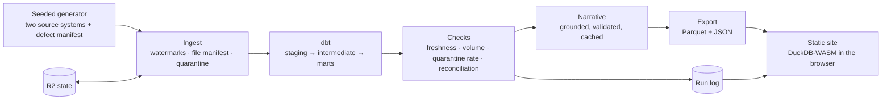

# Advisor Pulse: a weekly advisor-activity report, built end to end

## For reviewers: three minutes

1. **0:00–0:45** — Read the business question, weekly measure and drill-down in the [weekly report](https://pulse.charliebuild.com/).
2. **0:45–1:30** — Inspect how assignment events rebuild point-in-time ownership in the [SCD2 model](https://github.com/welkincz/advisor-pulse/blob/main/dbt/models/intermediate/int_advisor_history.sql#L1).
3. **1:30–2:15** — Read the repeat-run and crash-recovery evidence in the [idempotency tests](https://github.com/welkincz/advisor-pulse/blob/main/tests/integration/test_idempotency.py#L84).
4. **2:15–3:00** — Compare the demonstrated capabilities, limits and tracked gaps with the [job-sample evidence map](https://github.com/welkincz/advisor-pulse/blob/main/docs/reviewer-map.md).

Advisor Pulse is a weekly batch pipeline and report for Maplecrest Bank, a fictional Canadian bank. Every number on this page comes from synthetic data. The data is generated with a fixed seed, loaded the way a real warehouse would load it, modelled in dbt, checked, explained in plain language by Claude, and published as a static site. The site updates once a week, after the weekly run.

## The problem

A reporting manager at a bank needs to answer the same questions every Monday:

- How much client activity did each region, district, branch and advisor have last week?
- How does that compare with the week before and the trailing quarter?
- Can I trust the figures?

The source data never arrives clean:

- **Two systems, two styles.** Activity comes from one system as weekly file drops. Client and advisor records come from another, with different naming conventions.
- **Late and duplicated rows.** Some rows arrive late, some arrive twice, and some are broken.
- **Moving people.** Advisors move between branches and clients change advisors, so "whose activity is this?" depends on the week you ask about.

The project rebuilds that situation on synthetic data and solves it the way I would want it solved at work. Loads are incremental and idempotent. History is explicit. Every check ties back to a known ground truth.

The lead question is what share of active clients in each portfolio heard from an advisor in the last 12 months. Nationally it rises gradually, from 82.9% in the first reported week to 86.5% in 2026-W43. The useful exceptions are in the detail: some branches and advisors lose ground while the nation improves. The report helps a manager find them; it does not claim that contact alone measures client outcomes.

## Architecture

| Step | What happens |
|---|---|
| Generate | A seeded generator writes two "upstream systems" plus a defect manifest: the list of every problem it injected on purpose. |
| Ingest | The loader picks up new files by watermark and file hash. It validates rows, quarantines rejects and loads the rest. |
| Model | dbt builds staging, intermediate and mart layers, with enforced contracts on the marts. |
| Check | The runner checks the week's freshness, volume, quarantine rate and defect reconciliation. |
| Narrate | Claude turns each week's figures into short notes for every region and district. A validator rejects any number that isn't in the figures. |
| Export | The marts are exported to Parquet and JSON. |
| Publish | The browser queries the exported files with DuckDB-WASM, so the site needs no server. |

GitHub Actions runs the whole pipeline every Monday through one Python runner, which writes every stage to a run log. The [pipeline page](/pipeline) replays the latest run from that log, and the code is on [GitHub](https://github.com/welkincz/advisor-pulse).

## Key decisions

**SCD2 from events, not `dbt snapshot`.** Advisor history is rebuilt from assignment events in an intermediate model. A snapshot records what the table looked like when the job happened to run, so a backfill of week 12 would see this week's assignments. Building history from events makes every week reproducible. The cost is a more complex model and a test suite that has to cover transfers, promotions and terminations within a week.

**Watermarks on extract time, not event time.** Late activity is picked up because the loader asks "which files are new?", not "which events are new?". Each batch is deleted and re-inserted in one transaction, together with its watermark and manifest entry, so a rerun gives the same row counts and the same mart hashes.

**DuckDB everywhere.** The same engine runs in the pipeline and in the browser. At about 2.2 million activity rows that is plenty. It also removes a whole class of "the dashboard query disagrees with the warehouse" bugs, and the site needs no backend.

**State in object storage.** Actions runners are thrown away after every job, and the Actions cache can evict entries after seven days, exactly one weekly interval. The warehouse and sources therefore persist to Cloudflare R2 between runs. If that state is lost, the runner falls back to a deterministic cold rebuild. The fallback is the same backfill path, and it is tested.

**A grounded LLM, used narrowly.** The model only sees a compact list of facts for one node and week, each fact with an ID. It must cite a fact for every claim. Any number that doesn't match a cited fact sends the narrative back once, then falls back to a template. Results are cached by a hash of prompt version, model and facts, so reruns cost nothing. The page labels every narrative as AI-generated and can show the facts it used.

## Data quality, with ground truth

The generator injects realistic defects and writes a manifest of every one. The pipeline has to handle each defect as designed, and the reconciliation check (DQ033) compares the manifest with what actually happened, week by week.

This table covers the latest rebuild, 107 weeks of history:

| Defect | Handling | Injected |
|---|---|---:|
| Null activity id | Quarantine (DQ001) | 2,989 |
| Invalid enum | Quarantine (DQ002) | 1,490 |
| Duration out of range | Quarantine (DQ003) | 1,488 |
| Exact duplicates | Dedupe (DQ010) | 20,742 |
| Resent updates | Dedupe, latest version wins (DQ010) | 42,765 |
| Dirty postal codes | Normalize (DQ011) | 23,092 |
| Unknown advisor | Map to an unknown member (DQ012) | 4,473 |
| Late-arriving activity | Keep, flagged | 59,398 |

- **Reconciliation:** DQ033 passed in all 107 weeks, with nothing missing and nothing unexpected.
- **Quarantine:** the three quarantine defects add up to 5,967 rows, exactly the size of the quarantine table.
- **Volume:** the volume check warned on 8 weeks and failed on none. All 8 were the first weeks, without enough history yet. An earlier version also warned on holidays and small dips; the check now compares each week with a business-calendar expectation and ignores changes under 5%.
- **The lead KPI, computed twice:** a separate Python script recomputes the 12-month contacted rate from the raw extracts, sharing no code with dbt or ingest, and must match the marts for every portfolio, advisor and org node in every week, in CI and on a full-size run.

The full numbers are in [baseline.md](https://github.com/welkincz/advisor-pulse/blob/main/docs/baseline.md).

## Scale and speed

| | |
|---|---:|
| Weeks of history | 107 (2024-W41 to 2026-W43), after a one-year warm-up |
| Activity rows read | 2,286,280 |
| Activity rows after dedupe and quarantine | 2,216,806 |
| Full rebuild on GitHub Actions | 1 h 18 min, in one run (was 6 h 22 min) |
| One weekly run | about 10 minutes, 8 of them restoring state; plus about 9 minutes of model narratives |
| Published site data | 11.3 MB (budget 20 MB) |

A rebuild used to replay the whole pipeline for every week. It now ingests the weeks in order, then builds, checks and publishes once ([#275](https://github.com/welkincz/advisor-pulse/issues/275)). Most of what remains is the generator. A weekly run spends most of its time downloading state to a fresh runner.

## Failure handling

Every stage writes its attempts, timings and row counts to the run log. Transient errors retry with backoff. A failing check stops the data from being published, but the run log is still published, so the site keeps the last good week alongside the failed run's status. A failed run also opens a GitHub issue that lists the failing stages and checks, and the next healthy run closes it. A backfill runs through exactly the same code as a weekly run, one week at a time.

## What the integration run caught

Running the whole thing at full scale found three problems that unit tests did not:

1. **A polluted baseline.** The volume check's baseline included the partial weeks before the first extract, which hold only late rows. That made the trailing average too low. The fix limits the baseline to weeks the data actually covers.
2. **An export over budget.** Narrative history had no limit. At about 290 KB a week, the export passed the 20 MB budget at week 54. The fix publishes only the latest 26 weeks, in compact JSON.
3. **Slow CI.** CI went from minutes to 29 minutes once the runner called the real generator at full size. Tests now run the generator at a small size through one shared fixture.

## How it was built

I planned the project as a set of contracts and a backlog of small issues. Each issue named the paths it owned and its acceptance criteria.

- **Wave 0** came first: contracts and deterministic fixtures. Every later lane could then work in parallel against fixtures instead of waiting for upstream code.
- **The agents:** Claude Code, Codex and Cursor took issues by label, worked one branch per issue, and opened small pull requests.
- **Review:** Claude reviewed every pull request against a checklist covering contracts, idempotency, failure paths and tests. I approved anything that changed a contract or the plan.
- **The record:** every change went through an issue and a pull request; the full history is on [GitHub](https://github.com/welkincz/advisor-pulse/pulls?q=is%3Apr+is%3Amerged).

The process made one thing very clear: the contracts and fixtures did most of the coordination work.

## What would change at real scale

- **Warehouse:** Snowflake or BigQuery instead of DuckDB, with dbt Cloud or a scheduled dbt job.
- **Orchestration:** Dagster or Airflow instead of a cron job and a Python runner, for asset-level retries, backfills and lineage in one place.
- **Sources:** change-data capture from the source systems instead of file drops. That changes ingestion more than anything else.
- **Quality checks:** they would move into the orchestrator's asset checks, alerting to an on-call channel instead of a GitHub issue.
- **Access:** row-level security on advisor data and an audit trail for who saw what.

The parts I would keep: deriving history from events, idempotent batches, reconciling against known ground truth, and a narrow, grounded use of an LLM.

## Honest limits

- The data is synthetic, and so are the defects.
- The report is weekly, by design.
- Advisors and clients are generated. Only the geography (public FSA boundaries) is real.
- The narratives for the 106 historical weeks are templates. Only weeks run with a model backend get model-written text.
